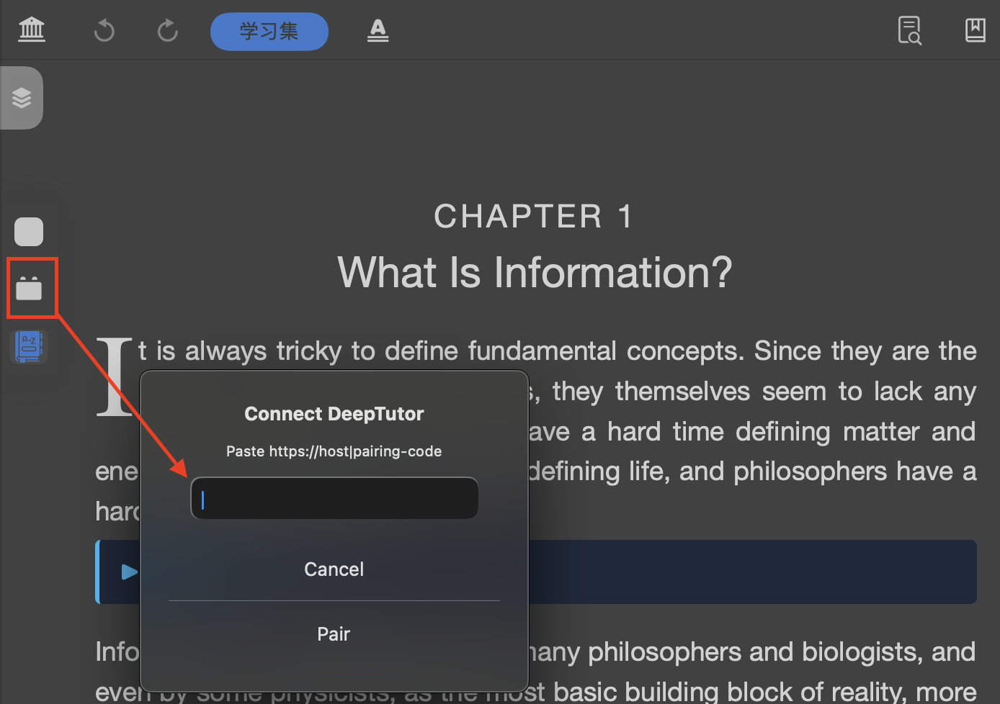

# MNRuntimeLib


A base library repository for MarginNote plugin development, providing MarginNote object wrappers, runtime integration capabilities, and a set of reusable utility functions.

This project is a pure base-layer version tailored, split, and reorganized based on Feliks's MNUtils code, positioned as the foundational library for MarginNote plugin development.

## Features

- **MarginNote Object Wrappers**
  Provides unified access to common objects such as notes, comments, documents, and notebooks.
- **Runtime Infrastructure**
  Provides lifecycle dispatch, broadcast route registration, resource path resolution, and a basic WebView shell.
- **Common Utility Functions**
  Contains low-level capabilities such as file read/write, URL handling, JSON repair, Markdown conversion, compression/decompression, and image/PDF conversion.
- **Reusable Resources and Pages**
  Built-in language packs, JSON Editor page, and required static assets, making it easy for plugins to integrate quickly.

## Core APIs

### Runtime

The core entry point of the runtime, primarily used to register lifecycles and handle inner routing in plugins.

```js
Runtime.registerLifecycle({
  sceneWillConnect() {
    MNUtil.showHUD("Runtime loaded")
  }
})
```

```js
Runtime.registerRoute("ping", () => {
  MNUtil.showHUD("pong")
})
```

### MNUtil

Common utility entry point, containing various tools to handle files, assets, windows, URLs, and WebViews.

```js
let path = Runtime.assets.resolve("assets/dot.png")
let webview = MNUtil.createJsonEditor()
webview.frame = MNUtil.genFrame(20, 80, 800, 600)
MNUtil.studyView.addSubview(webview)
```

### MNNote

MarginNote object wrapper entry point.

```js
let note = MNNote.new("note-id")
```

## Fork Experience Notes

### MarginNote 4 JSB helper dispatch

Verified on MarginNote 4: AddonLib's `MNUtil.userInput` can present the native
text-input dialog from a mounted study window. The wrapper itself is not the
failure point when a host add-on toolbar action opens no UI.

The observed host-side failure pattern is declaring ordinary JavaScript helper
methods inside the object passed to `JSB.defineClass` and then calling them as
`this.helper()` or `self.helper()` from lifecycle callbacks or Objective-C
selectors. On this runtime, lifecycle callbacks and registered selectors are
reachable, but those ordinary helpers are not necessarily exposed as instance
methods. A failing call may therefore terminate before AddonLib displays its
input dialog.

Host add-ons should use either of these patterns:

- Keep plain helper workflows as top-level functions and pass the add-on
  instance explicitly, for example `openPairingIfNeeded(addon)`.
- Or assign helpers to the returned class prototype after `JSB.defineClass`
  returns, following the established MarginNote add-on pattern.

This is integration guidance for host add-ons. No AddonLib API change or
upstream issue/PR is required.

### Verification Status

The developers have verified the functionality up to this step:



*Note: The development team has only tested up to this step. We welcome the community to share and feedback subsequent test results.*

## License Statement

The relevant code in this project has been authorized and is released under the MIT License.

Anyone is free to use, modify, distribute, and reuse the code in this repository subject to compliance with the MIT License terms.

For specific license terms, please see [LICENSE](LICENSE).
